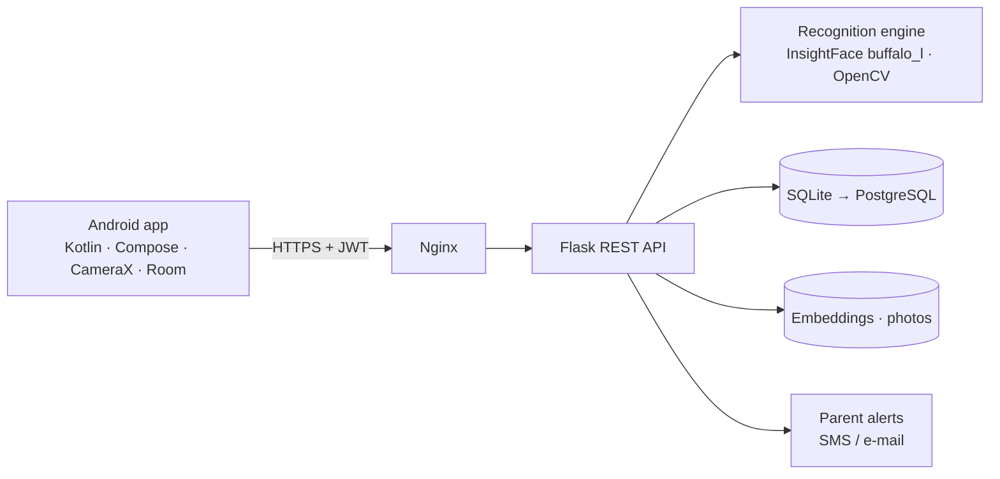

<h1 align="center">EduLens</h1>

<p align="center"><b>Face-recognition attendance for Sai Vidya Institute of Technology (SVIT), Bengaluru.<br/>One classroom photo, teacher-confirmed attendance, parent alerts and VTU 85% shortage tracking, all on a campus server.</b></p>

<p align="center">
  
  
  
  
  
  
</p>

**Team:** Likhith M (1VA23CD044), Lekhana Jain R (1VA23CD043), Darshan H N (1VA23CD025), Nikesh (1VA23CD058)
**Guide:** Prof. Pulukuri Aparna, Dept. of CSE (Data Science), SVIT. **YUKTI Innovation ID:** IR2026-1060038

## Problem

Roll-call takes 5–10 minutes of every lecture, proxy attendance is easy, and students usually learn about a
shortage only at semester end, when VTU's **85% per course** rule already bars them from the SEE.

## Solution

1. Faculty starts a session for subject + section and takes 1–4 classroom photos.
2. The server detects every face (RetinaFace), creates a 512-d ArcFace embedding, and matches it **only against
   that section's roster** (cosine ≥ 0.45 with a 0.03 margin over the second-best student).
3. Matches are **candidates only**. The teacher reviews (check / uncheck / add by hand) and confirms.
4. Confirmation writes Present **and Absent** for every roster student in one transaction and locks the session.
5. Parents of absent students get an SMS/e-mail; weekly alerts go out for anyone below 85%.
6. Students see subject-wise attendance, how many classes they can still miss, IA marks and deadlines.

## Features

| Role | What they can do |
|---|---|
| **Administrator / HOD** | Create accounts, import the roster CSV (with parent contacts), enroll faces, view analytics and shortage lists, send shortage alerts |
| **Faculty** | Start a session, capture photos, review and confirm, enter IA marks, post assignment deadlines |
| **Student** | Subject-wise attendance %, classes they can miss / must attend to reach 85%, IA marks, upcoming deadlines |
| **Parent** | SMS / e-mail on confirmed absence and when attendance drops below 85% |

## Architecture



Everything runs on one college-owned server; no face data leaves campus.

## API

| Method | Route | Purpose |
|---|---|---|
| POST | `/login` | JWT login (roles: administrator, hod, teacher/faculty, student) |
| POST | `/api/users` | Admin creates faculty / HOD / student accounts |
| POST | `/api/students`, `/api/students/import` | Add one student, or import a roster CSV (see `backend/sample_roster.csv`) |
| PUT | `/api/students/<id>/parent` | Update parent name / phone / e-mail |
| POST | `/api/enroll`, `/api/train` | Upload face photos (`parentPhone` optional), rebuild gallery |
| POST | `/api/sessions/start` | Start a session (one per faculty / section at a time) |
| POST | `/api/recognize` | Photo → **candidates** for the active session (call up to 4 times) |
| GET | `/api/sessions/<id>/review` | Roster with detected flags and confidence for the review screen |
| POST | `/api/attendance/confirm` (or `/api/sessions/end`) | Confirm `presentStudentIds`, write Present + Absent, lock, alert parents |
| POST | `/api/sync` | Offline records (never overwrite a confirmed session) |
| GET | `/api/attendance`, `/api/reports`, `/api/weekly-summary`, `/api/analytics`, `/api/low-attendance` | Records and analytics (default threshold 85%) |
| GET | `/api/me/attendance`, `/api/me/marks`, `/api/me/assignments` | Student portal |
| POST/GET | `/api/ia-marks`, `/api/assignments` | IA marks and assignment deadlines |
| POST | `/api/notifications/parents/shortage` | Alert parents of students below 85% (once per student, subject, week) |
| POST | `/api/notifications/parents/absent/<sessionId>` | Re-run absence alerts for a session |
| POST | `/api/notifications/parents/test` | Send a test SMS / e-mail |
| GET | `/api/notifications/parents` | Log of every parent message and its delivery status |

## Run it

```bash
cp .env.example .env              # set JWT_SECRET; PARENT_SMS_PROVIDER=log for a demo
docker compose up -d --build      # API on http://<server-ip>:5000
docker compose exec backend python create_first_admin.py
```

Without Docker: `cd backend && pip install -r requirements.txt && python create_first_admin.py && python app.py`.

**Android app:** set `EDULENS_API_URL=http://<server-ip>:5000/` in `gradle.properties`, then build in Android Studio.

**Tests:** `cd backend && python -m unittest discover tests -v` (face model is stubbed, runs in under a second).

## Parent alerts

Set `PARENT_SMS_PROVIDER` in `.env`:

| Value | What happens |
|---|---|
| `log` | Message printed to the server log and stored; nothing sent (demo) |
| `fast2sms` | Fast2SMS (`FAST2SMS_API_KEY`; route `q` works without DLT for testing) |
| `msg91` | MSG91 Flow API (`MSG91_AUTH_KEY`, `MSG91_FLOW_ID`) |
| `twilio` | Twilio (`TWILIO_ACCOUNT_SID`, `TWILIO_AUTH_TOKEN`, `TWILIO_FROM_NUMBER`) |

E-mail: `PARENT_EMAIL_ENABLED=true` plus `SMTP_*` (a college Gmail account with an App Password works).
Production SMS in India needs a DLT-registered sender ID and templates; the two message templates are in
`backend/services/parent_notifier.py`.

## Privacy and limitations

- Face images and embeddings are biometric personal data under India's DPDP Act, 2023. Collect written consent,
  keep the server on the campus network, delete a student's data when they leave.
- Recognition accuracy has not yet been benchmarked on full 60–70 student classes; the teacher review step
  exists because the model will sometimes miss or mis-match faces.
- No liveness check yet; a held-up photo could be detected. Planned.
