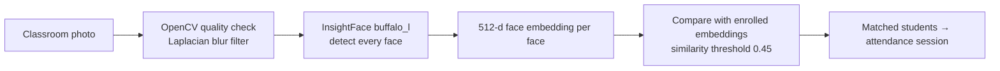
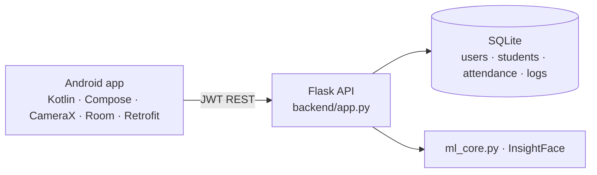

<h1 align="center">👁️ EduLens</h1>

<p align="center"><b>Face-recognition attendance from a single classroom photo: an Android app for teachers and admins, and a Flask API that runs the recognition locally with no paid APIs.</b></p>

<p align="center">
  
  
  
  
  
  
</p>

## Problem

Calling the roll takes minutes from every lecture and is easy to proxy. EduLens lets a teacher take **one photo of the class**; the system detects every face, identifies enrolled students and records attendance.

## Features

| Role | Capabilities |
|---|---|
| **Administrator** | Register students (ID, USN, department, semester, section), enroll face images, retrain the model, view reports |
| **Teacher** | Capture a classroom photo with CameraX, get recognised students back, review and sync attendance |
| **Offline-first** | Room database on the device; records sync to the server through `/api/sync` |

## How recognition works



## Architecture



## API (summary)

| Method | Route | Purpose |
|---|---|---|
| POST | `/login`, `/register` | JWT auth with administrator/teacher roles |
| POST | `/api/students` | Create a student record |
| POST | `/api/enroll` | Upload face images for a student |
| POST | `/api/train` | Rebuild the enrolled-embedding gallery |
| POST | `/api/recognize` | Recognise students in a classroom photo |
| POST | `/api/sync` | Sync offline attendance records |
| POST/GET | `/api/sessions/start`, `/api/sessions/end`, `/api/sessions` | Attendance sessions |
| GET | `/api/attendance`, `/api/reports`, `/api/weekly-summary`, `/api/analytics` | Records and analytics |
| GET | `/api/low-attendance`, `/api/notifications` | Low-attendance alerts |

Full request and response examples: [`api.md`](api.md). Older design notes: [`architecture.md`](architecture.md) (describes an earlier MediaPipe + RandomForest pipeline; the current code uses InsightFace).

## Run locally

```bash
# Backend
cd backend
pip install -r requirements.txt
python create_first_admin.py
python app.py

# Android app
# Open the project root in Android Studio, set the API base URL, then Run ▶
```

Docker and database setup: [`deployment.md`](deployment.md).

## Privacy and limitations

- Face images and embeddings are **biometric data**. Store them only with consent, keep the server on a trusted network and delete data when a student leaves.
- Recognition accuracy depends on photo resolution, pose and lighting, and has not been benchmarked on a public dataset. The 0.45 threshold trades misses against false matches; tune it per classroom.
- Location/GPS-based attendance is **not** implemented.
