<div align="center">


# EduLens

**Face-recognition attendance for Sai Vidya Institute of Technology (SVIT), Bengaluru**

One classroom photo · Teacher-verified register · Parent SMS alerts · VTU 85% tracking · Runs on a campus server

[](https://github.com/nvaltryek-001/Edulens/actions/workflows/ci.yml)


</div>

---

## Demo

<p align="center">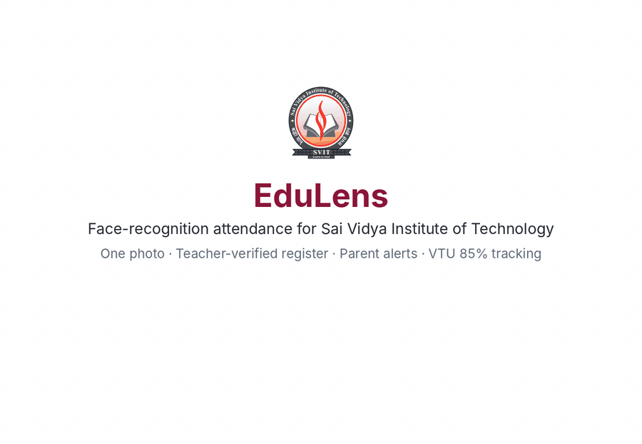</p>

<p align="center"><b><a href="docs/media/edulens_demo.mp4">▶ Watch the full demo video (MP4, 56 s)</a></b></p>

The walkthrough is recorded from the running system with test data. A faculty member starts a session for BCS701, uploads a classroom photo, reviews the 9 faces the camera matched, adds one student it missed, and confirms. The register for all 12 students is then saved and locked. The video continues through the 85% shortage list, parent alerts, IA marks, the admin roster and the student dashboard.

| Item | Details |
|---|---|
| **Team** | Likhith M (1VA23CD044) · Lekhana Jain R (1VA23CD043) · Darshan H N (1VA23CD025) · Nikesh (1VA23CD058) |
| **Guide** | Prof. Pulukuri Aparna, Assistant Professor, Dept. of CSE (Data Science), SVIT |
| **YUKTI Innovation ID** | IR2026-1060038 |
| **Exhibition** | TECHSPARDHA, Project Exhibition 2K26, SVIT, 21 November 2026 |

---

## Contents

1. [Problem statement](#problem-statement)
2. [Solution](#solution)
3. [Features by role](#features-by-role)
4. [Screenshots](#screenshots)
5. [System architecture](#system-architecture)
6. [Attendance workflow](#attendance-workflow)
7. [AI recognition pipeline](#ai-recognition-pipeline)
8. [Technology stack](#technology-stack)
9. [Project structure](#project-structure)
10. [Database design](#database-design)
11. [API reference](#api-reference)
12. [Getting started](#getting-started)
13. [Parent alerts (SMS / e-mail)](#parent-alerts-sms--e-mail)
14. [Testing and CI](#testing-and-ci)
15. [Security and privacy](#security-and-privacy)
16. [What was built in this version](#what-was-built-in-this-version)
17. [Limitations and roadmap](#limitations-and-roadmap)

---

## Problem statement

> Design and deploy a secure, on-premise system that records class attendance at SVIT from classroom photographs using face recognition. The faculty member stays in control of the final record. Students, faculty, HODs and parents get timely visibility of attendance against the VTU requirement of **85% per course**.

| Problem today | Effect |
|---|---|
| Manual roll-call of 60–70 names | 5–10 minutes of every 55-minute lecture is lost |
| Proxy attendance ("present" for a friend) | Hard to catch in large sections |
| Shortage found only at semester end | Students are barred from the SEE (NSAR) with no time to recover |
| Paper registers and spreadsheets | Retyping, errors, slow reports |
| Algorithm output saved directly (older systems) | A wrong match becomes the official record, with no correction |
| Cloud face APIs | Student faces leave campus; per-call cost |

## Solution

1. The faculty member **starts a session** for a subject and section.
2. They take **1–4 classroom photos** (left, centre, right and back rows) with the app or any phone browser.
3. The server **detects every face** (RetinaFace) and computes a **512-d ArcFace embedding**. Each face is matched **only against that section's roster**: cosine similarity must be at least 0.45, with a 0.03 margin over the second-best student.
4. Matches are **suggestions**. The teacher **reviews**: ticks or unticks students, uses "all present / all absent", and notes a reason for manual changes.
5. On **confirm**, Present and **Absent** are written for every student on the roster in one transaction, and the session **locks**.
6. **Parents of absent students get an SMS/e-mail**. A weekly job alerts parents of anyone below **85% in any subject**.
7. **Students** see their attendance per subject, how many classes they can still miss or must attend, their IA marks and upcoming deadlines.

## Features by role

| Role | Web portal | Flutter app | Kotlin app |
|---|:-:|:-:|:-:|
| **Faculty:** start session, photos, review, confirm | ✅ | ✅ | ✅ |
| **Faculty:** per-subject 85% shortage list, alert parents | ✅ | ✅ | ✅ (overall) |
| **Faculty:** parent alert log | ✅ | ✅ | |
| **Faculty:** IA marks entry, assignment deadlines | ✅ | ✅ | |
| **Admin / HOD:** roster CSV import, one-click student logins, accounts, parent mobiles | ✅ | | |
| **Everyone:** sign in with USN or college e-mail, change password | ✅ | ✅ (sign-in) | |
| **Admin:** face enrollment (3–5 photos per student) | | | ✅ |
| **Admin:** analytics, weekly summary, reports | | | ✅ |
| **Student:** subject-wise %, classes to attend or can miss, marks, deadlines | ✅ | ✅ | |
| **Parent** (or the student, if no parent number): SMS / e-mail on absence and on shortage | automatic | automatic | automatic |
| **Student:** weekly attendance e-mail | automatic | automatic | automatic |

All three clients use the same Flask API, so a college can roll out the web portal on day one and add the apps later.

## Screenshots

| Faculty: class details | Review: camera matches pre-ticked | Teacher correction before saving |
|:-:|:-:|:-:|
| 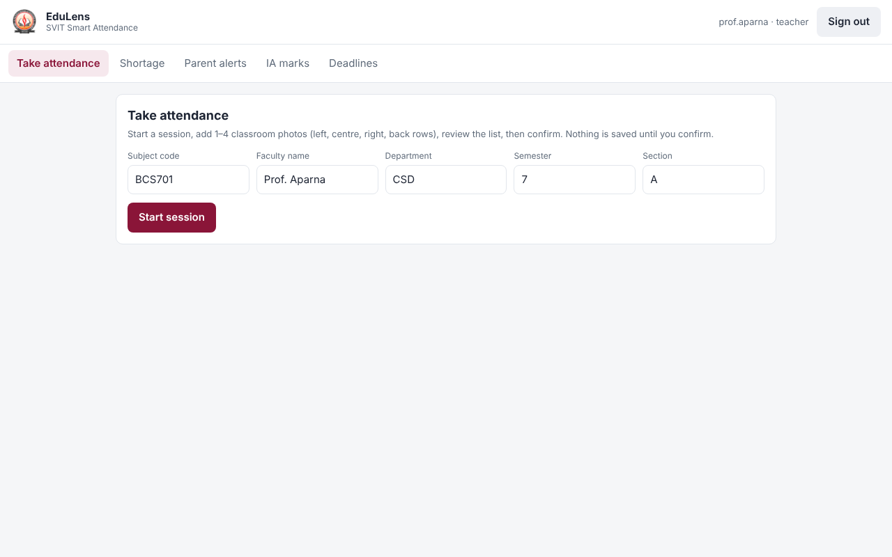 | 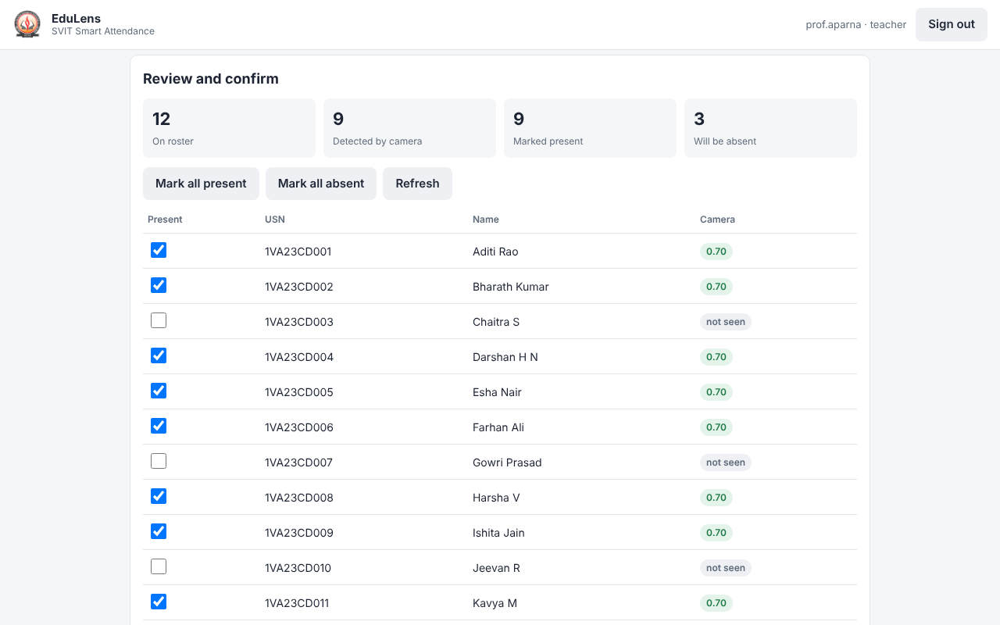 | 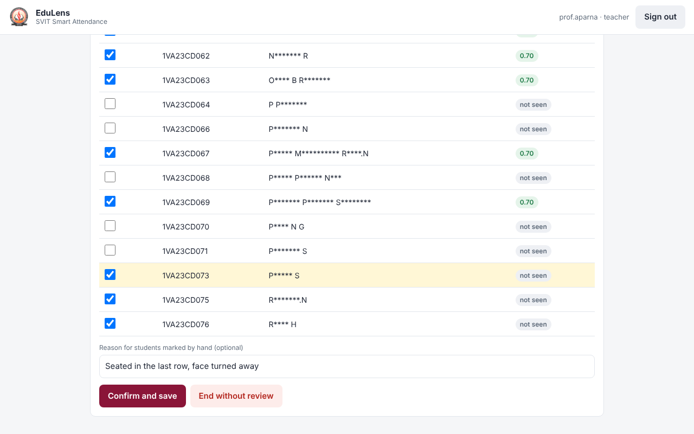 |
| **Per-subject VTU 85% shortage** | **Parent alert log** | **IA marks entry** |
| 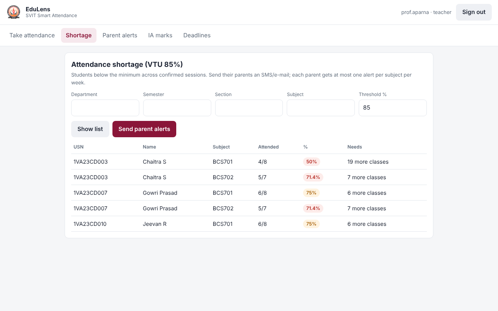 | 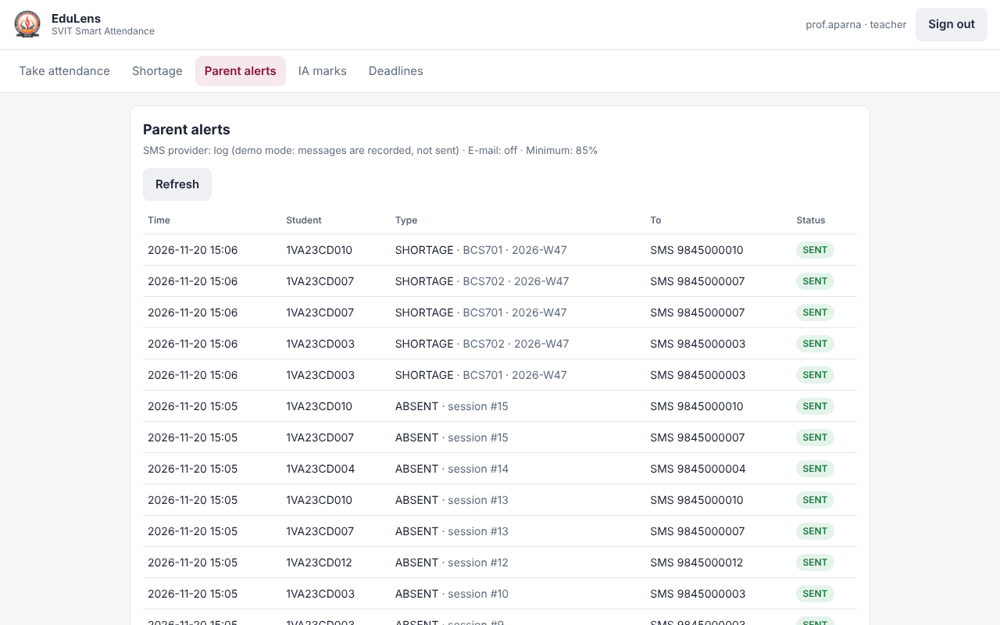 | 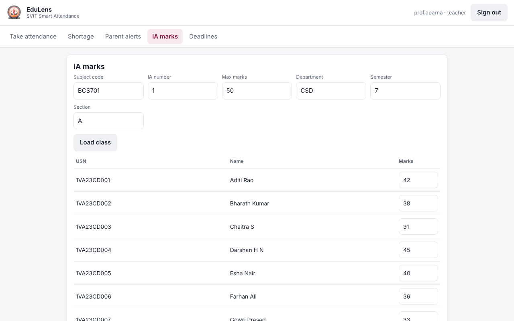 |
| **Admin: roster, accounts, parent mobiles** | **Student dashboard** | **Sign in** |
| 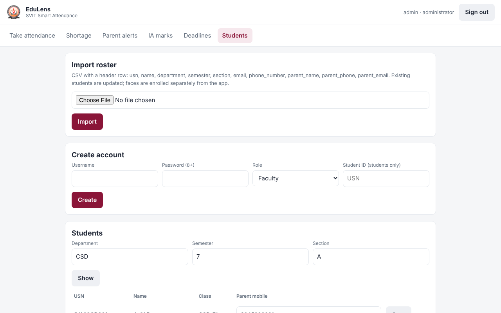 | 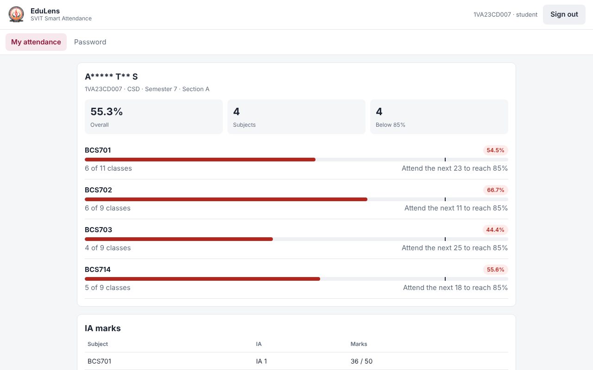 | 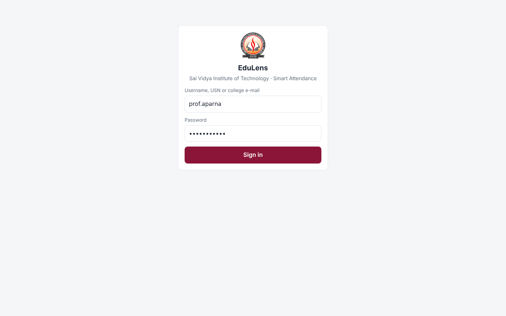 |

## System architecture

<p align="center">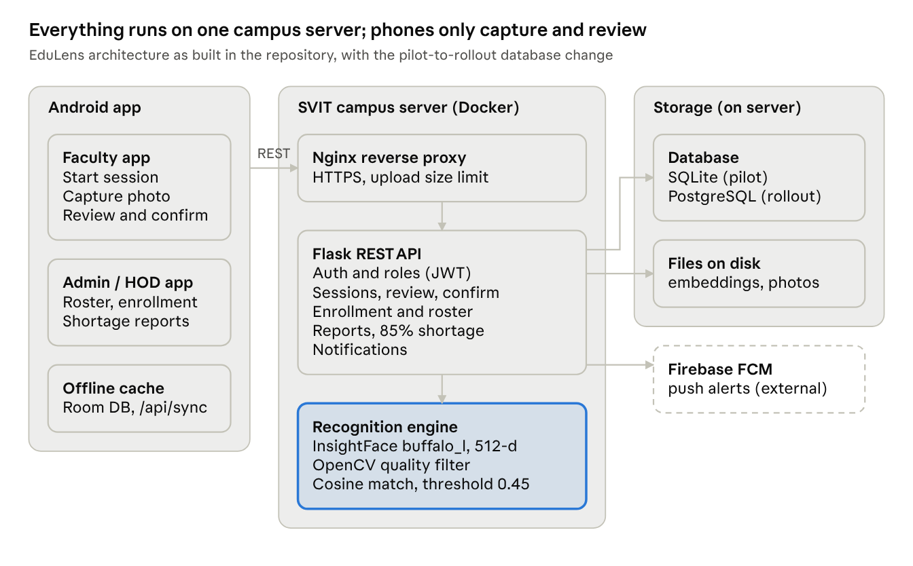</p>

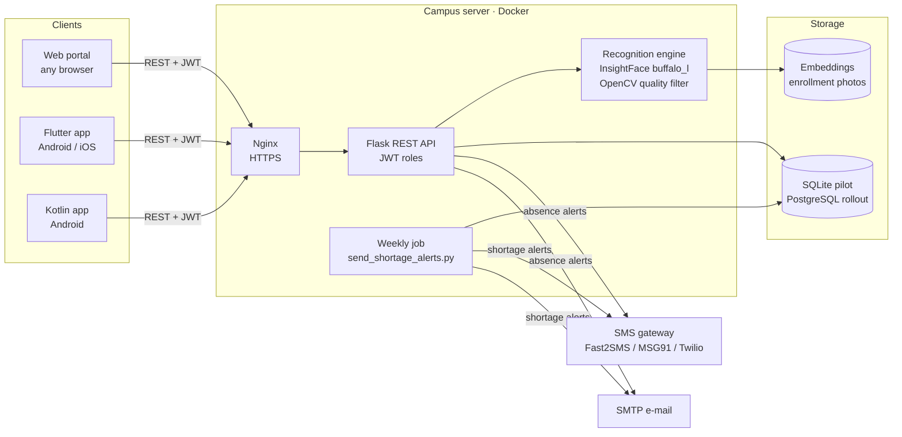

- **Client–server.** Phones only capture and display; all face processing runs on one college-owned server.
- **No paid AI APIs.** InsightFace runs on CPU through ONNX Runtime.
- **Biometric data stays on campus.** Embeddings and enrollment photos never leave the server.

## Attendance workflow

<p align="center">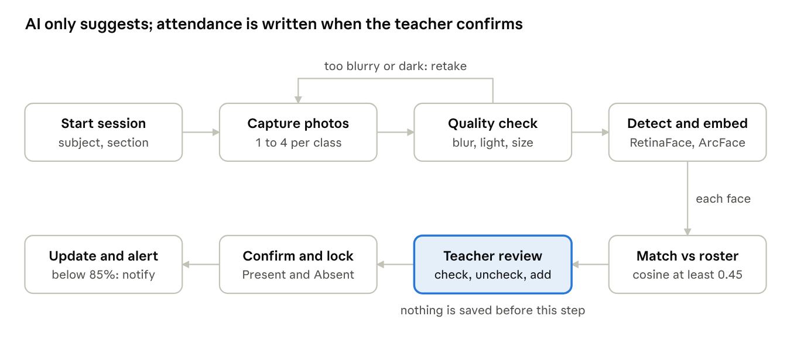</p>

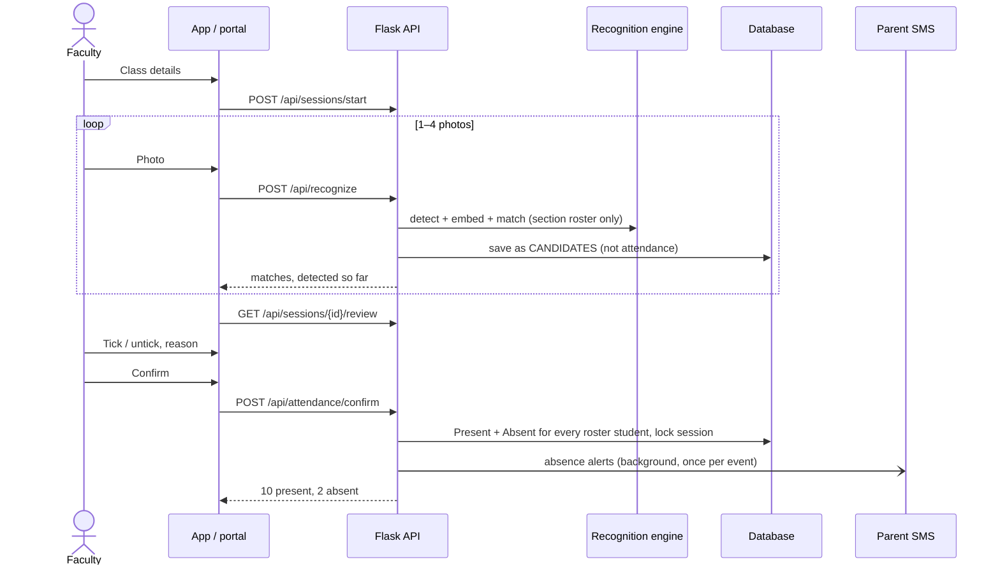

Two rules hold throughout. **Unknown faces never make anyone absent**: absence is derived from the roster only at confirmation. **A student seen in several photos counts once.**

## AI recognition pipeline

| Stage | Implementation (`backend/ml_core.py`) |
|---|---|
| Quality filter | OpenCV: minimum face size, Laplacian blur score, brightness range |
| Detection | RetinaFace (InsightFace `buffalo_l`), 640×640 detector input |
| Alignment | 5 facial landmarks |
| Embedding | ArcFace, 512-dimensional, L2-normalised |
| Matching | Cosine similarity against **the selected section's** enrolled embeddings only |
| Decision | Best ≥ 0.45 **and** best − second-best ≥ 0.03, otherwise "unknown" |
| Human check | Teacher review screen; nothing is saved before confirmation |

The decision rule, where q is a face from the photo and e is an enrolled embedding:

```math
\mathrm{sim}(q, e) = \frac{q \cdot e}{\lVert q \rVert \, \lVert e \rVert}, \qquad
\text{accept } s^{*} \iff \mathrm{sim}_{1} \ge 0.45 \;\wedge\; \mathrm{sim}_{1} - \mathrm{sim}_{2} \ge 0.03
```

Students see two projections, with p = classes present, n = classes held and m = 0.85:

```math
\text{can miss} = \left\lfloor \frac{p}{m} - n \right\rfloor, \qquad
\text{must attend} = \left\lceil \frac{m n - p}{1 - m} \right\rceil
```

## Technology stack

| Layer | Technology | Why |
|---|---|---|
| Flutter app | Flutter 3.27+, Material 3, `http`, `image_picker`, `shared_preferences` | One codebase for Android and iOS, as in the project report |
| Kotlin app | Kotlin, Jetpack Compose, CameraX, Room (offline), Retrofit + Moshi | Native camera; offline records sync later |
| Web portal | Single-page HTML/JS served by Flask (`/portal`) | Zero install; works on any phone browser |
| API | Flask 3, Gunicorn, PyJWT, Flask-CORS | Python, same language as the ML code |
| Face AI | InsightFace `buffalo_l` (RetinaFace + ArcFace) on ONNX Runtime CPU | Accurate, free, runs on campus hardware |
| Image quality | OpenCV | Rejects blurred, dark or tiny faces |
| Database | SQLite (WAL) for the pilot → PostgreSQL for college-wide | Zero setup now, concurrency later |
| Parent alerts | Fast2SMS / MSG91 / Twilio, SMTP e-mail | Indian SMS gateways plus a free e-mail option |
| Push | Firebase Cloud Messaging (optional) | Free Android push |
| Deployment | Docker Compose, Nginx (HTTPS), cron | One-command setup on any campus machine |
| CI | GitHub Actions | Backend tests, Flutter analyze/test/APK, Kotlin APK |

## Project structure

```text
Edulens/
├── backend/                         Flask API + AI + web portal (runs on the campus server)
│   ├── app.py                       Core API: auth, enrollment, sessions, recognition, confirm, reports
│   ├── portal_routes.py             Student portal, IA marks, deadlines, accounts, roster, shortage, /portal
│   ├── ml_core.py                   InsightFace detection, embeddings, quality filter, roster-only matching
│   ├── database.py                  SQLite schema + migrations (WAL, unique session/student rows)
│   ├── auth.py                      JWT issue/verify, role decorator
│   ├── services/
│   │   ├── parent_notifier.py       SMS (Fast2SMS/MSG91/Twilio) + e-mail, de-duplicated per event
│   │   └── notification_service.py  Firebase push (optional)
│   ├── static/portal/index.html     Web portal (faculty, admin, student)
│   ├── send_shortage_alerts.py      Weekly cron job: parents of students below 85%
│   ├── create_first_admin.py        Creates the first administrator account
│   ├── sample_roster.csv            Roster import format (synthetic data)
│   ├── tests/test_attendance_flow.py End-to-end API tests (face model stubbed)
│   ├── Dockerfile · requirements.txt
├── flutter_app/                     Flutter client (Android / iOS)
│   ├── lib/
│   │   ├── main.dart                Role-based routing
│   │   ├── api/api_client.dart      REST client, token storage
│   │   ├── screens/                 login, faculty_home, attendance, shortage, alerts, marks, student_home
│   │   ├── widgets/common.dart      Cards, stat tiles, pills
│   │   └── theme.dart · config.dart SVIT maroon theme, server URL, 85% constant
│   ├── setup_platforms.sh           Generates android/ios folders with permissions
│   └── test/widget_test.dart
├── app/                             Kotlin + Jetpack Compose Android app
│   └── src/main/java/com/example/
│       ├── api/                     Retrofit service + models (review, confirm)
│       ├── data/                    Room offline database
│       └── ui/screens/              Login, Dashboard, Enrollment, Attendance (+ review dialog), Reports
├── tools/vtu_excel_to_roster.py     Class Excel sheet (USN, name, e-mail, mobile) → roster CSV
├── docs/
│   ├── media/                       Demo video, GIF, screenshots, diagrams
│   └── SVIT_Smart_Attendance_Project_Guides/   Design guides (architecture, DB, RBAC, privacy)
├── .github/workflows/ci.yml         CI: backend tests, Flutter APK, Kotlin APK
├── docker-compose.yml · .env.example
├── deployment.md                    Campus deployment guide
└── api.md                           API request/response examples
```

## Database design

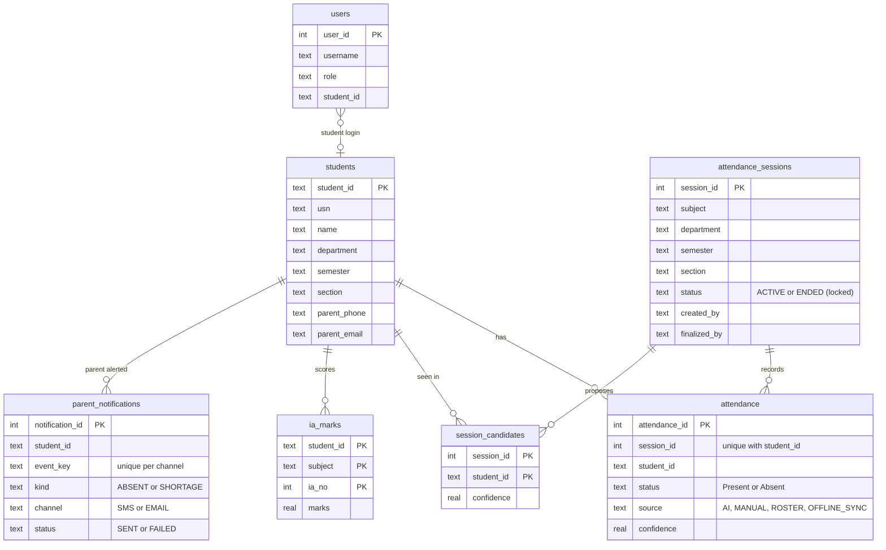

Two further tables complete the schema: `assignments` (deadlines per section) and `logs` (audit of every confirmation: who confirmed, AI matches rejected, manual additions and the reason).

## API reference

All routes except `/login` and `/portal` need `Authorization: Bearer <JWT>`. See [`api.md`](api.md) for request and response examples.

| Method | Route | Who | Purpose |
|---|---|---|---|
| POST | `/login` | all | JWT for administrator, hod, teacher/faculty, student (students may use USN or college e-mail) |
| POST | `/api/users` | admin | Create faculty, HOD and student accounts |
| POST | `/api/students/create-accounts` | admin | Logins for every student without one; returns temporary passwords once, can e-mail them |
| POST | `/api/me/password` | all | Change own password |
| GET / POST | `/api/students` | staff / admin | List roster / add a student |
| POST | `/api/students/import` | admin, HOD | Roster CSV with parent contacts |
| PUT | `/api/students/<id>/parent` | admin, HOD | Update parent name, phone, e-mail |
| POST | `/api/enroll`, `/api/train` | admin | Enroll face photos, rebuild gallery |
| POST | `/api/sessions/start` | staff | Start a session (one per faculty member or section) |
| POST | `/api/recognize` | staff | Photo → candidates (no attendance written) |
| GET | `/api/sessions/<id>/review` | staff | Roster with camera matches |
| POST | `/api/attendance/confirm` | staff | Save Present + Absent, lock, alert parents |
| POST | `/api/sessions/end` | staff | Confirm using camera matches only |
| GET | `/api/sessions` | staff | Session list |
| POST | `/api/sync` | staff | Offline records (never into a locked session) |
| GET | `/api/shortage` | staff | Per-subject list below 85% |
| GET | `/api/attendance`, `/api/reports`, `/api/weekly-summary`, `/api/analytics`, `/api/low-attendance` | staff | Reports and analytics |
| GET | `/api/me/attendance`, `/api/me/marks`, `/api/me/assignments` | student | Student portal |
| GET / POST | `/api/ia-marks`, `/api/assignments` | staff | IA marks and deadlines |
| POST | `/api/notifications/parents/shortage` | staff | Alert parents of students below 85% (once a week) |
| POST | `/api/notifications/parents/absent/<id>` | staff | Re-run absence alerts for a session |
| POST | `/api/notifications/parents/test` | admin | Test SMS / e-mail |
| GET | `/api/notifications/parents`, `/api/notifications/parents/status` | staff | Alert log, provider status |
| GET | `/portal` | all | Web portal |
| GET | `/health` | all | Health check |

## Getting started

### 1. Server (Docker, recommended)

```bash
git clone https://github.com/nvaltryek-001/Edulens.git && cd Edulens
cp .env.example .env
python3 -c "import secrets; print(secrets.token_hex(32))"   # paste into JWT_SECRET
docker compose up -d --build
docker compose exec backend python create_first_admin.py
```

Open **`http://<server-ip>:5000/portal`** and sign in as the administrator.

<details>
<summary>Without Docker</summary>

```bash
cd backend
python -m venv .venv && source .venv/bin/activate     # Windows: .venv\Scripts\activate
pip install -r requirements.txt
python create_first_admin.py
python app.py                                        # http://0.0.0.0:5000
```
</details>

### 2. First-time setup at SVIT

1. **Convert the class sheet:** `pip install openpyxl && python tools/vtu_excel_to_roster.py VTU_Details_7th_sem.xlsx roster.csv --department CSD --semester 7 --section A`. It reads the USN, Name, Email and Mobile Number columns.
2. **Portal → Students → Import roster** with that CSV (format: [`backend/sample_roster.csv`](backend/sample_roster.csv)). Add parent mobiles later in the same screen.
3. **Portal → Students → Create student logins.** One click creates a login for every student (username = USN, or their `@saividya.ac.in` e-mail) and downloads the temporary passwords. Tick "E-mail each student" to send them automatically. Students change their password under **Password**.
4. **Portal → Students → Create account** for each faculty member and HOD.
5. **Kotlin app → Enrollment.** Enroll 3–5 face photos per student, in good light, after collecting written consent.
6. Faculty can now take attendance from the Flutter app, the Kotlin app or the portal.

> Real student data (names, mobiles, e-mails) stays on the college server. Never commit roster or password files: the repository is public, and `.gitignore` blocks `*.xlsx`, `roster_*.csv` and `credentials_*.csv`.

### 3. Flutter app

```bash
cd flutter_app
./setup_platforms.sh                                  # creates android/ and ios/ with permissions
flutter run --dart-define=API_URL=http://<server-ip>:5000
flutter build apk --release --dart-define=API_URL=http://<server-ip>:5000
```

CI also builds a release APK on every push. Download it from the **Actions → CI → edulens-flutter-apk** artifact.

### 4. Kotlin app

Set `EDULENS_API_URL=http://<server-ip>:5000/` in `gradle.properties`, open the project in Android Studio and run it. CI builds a debug APK (**edulens-kotlin-debug-apk**).

Full server sizing, HTTPS, backups and scaling are covered in [`deployment.md`](deployment.md).

## Parent alerts (SMS / e-mail)

| `.env` setting | Behaviour |
|---|---|
| `PARENT_SMS_PROVIDER=log` | **Demo mode.** Messages are stored and shown in the portal; nothing is sent |
| `PARENT_SMS_PROVIDER=android_gateway` + `ANDROID_GATEWAY_*` | **Free: SMS from your own Android phone's SIM** via the open-source [SMS Gateway for Android](https://github.com/capcom6/android-sms-gateway) app (Local Server mode, same Wi-Fi as the server) |
| `PARENT_SMS_PROVIDER=fast2sms` + `FAST2SMS_API_KEY` | Fast2SMS (route `q` for testing) |
| `PARENT_SMS_PROVIDER=msg91` + `MSG91_AUTH_KEY`, `MSG91_FLOW_ID` | MSG91 Flow with a DLT template |
| `PARENT_SMS_PROVIDER=twilio` + `TWILIO_*` | Twilio |
| `PARENT_EMAIL_ENABLED=true` + `SMTP_*` | E-mail, e.g. a college Gmail account with an App Password |

Message templates (`backend/services/parent_notifier.py`):

```text
Dear Parent, your ward Gowri Prasad (1VA23CD007) was absent for BCS701 on 2026-11-20 at 10:00.
Attendance in BCS701: 75.0%. - SVIT

Dear Parent, attendance of your ward Gowri Prasad (1VA23CD007) in BCS702 is 71.4%, below the
required 85%. Please contact the class teacher. - SVIT
```

- **No parent number yet?** With `NOTIFY_STUDENT_IF_NO_PARENT=true` (default) the alert goes to the student's own mobile and college e-mail, worded to the student.
- **Weekly self-update:** every Monday each student gets an e-mail with their subject-wise attendance and how many classes they can miss or must attend.
- Absence alerts go out automatically in the background when a session is confirmed.
- Shortage alerts and weekly summaries run from cron: `0 9 * * 1  docker compose exec -T backend python send_shortage_alerts.py` (shortage alerts can also be sent from the portal or app).
- Every message is stored with a unique (student, event, channel) key, so a parent is never alerted twice for the same absence or the same subject in the same week.
- Commercial SMS in India requires a DLT-registered sender ID and approved templates.

## Testing and CI

```bash
cd backend && python -m unittest discover tests -v
```

The end-to-end test (`backend/tests/test_attendance_flow.py`) stubs the face model and checks the following:

- Two teachers can run sessions in different sections at the same time.
- Recognition matches only the selected roster and writes **no** attendance.
- A duplicate face in a second photo is counted once.
- Another teacher cannot confirm your session.
- Confirmation writes Present + Absent, records manual additions and rejected AI matches, then locks the session.
- Roster import, one-click student logins, e-mail login, password change, student-phone fallback, weekly summary e-mail (once per week) and the Android phone SMS gateway call.
- The absence SMS is sent exactly once, and shortage lists and alerts are correct.
- The student portal, IA marks, deadlines and role restrictions work.

GitHub Actions ([`ci.yml`](.github/workflows/ci.yml)) runs these tests and builds both apps on every push.

## Security and privacy

- **Authentication:** passwords are hashed with Werkzeug (salted). JWTs expire after 24 h. Production refuses to start without a strong `JWT_SECRET`. Public registration is disabled.
- **Authorisation:** roles are checked on every route. Faculty can manage only their own sessions. Students see only their own records.
- **Integrity:** a confirmed session is locked, and offline sync cannot overwrite it. Every confirmation is audit-logged: who confirmed, manual additions, rejected matches and the reason.
- **Uploads:** JPG/PNG only, 25 MB limit and random filenames. Classroom photos are deleted right after processing.
- **Biometric data (India's DPDP Act, 2023):** collect written consent before enrollment and keep the server on the campus network. Use embeddings only for attendance, and delete a student's photos and embeddings when they leave.
- **Transport:** HTTP is allowed on the campus LAN for the pilot. Put Nginx with HTTPS in front before a college-wide rollout (see `deployment.md`).

## What was built in this version

| Area | Before | Now |
|---|---|---|
| Attendance record | Recognition wrote "Present" directly; Absent was never stored, so everyone showed 100% | Candidates → teacher review → confirm writes Present **and** Absent, then locks |
| Matching | Against every enrolled student in the college | Only against the selected section's roster |
| Concurrency | One active session in the whole college | One per faculty member or section; ownership checks |
| Shortage rule | 75%, overall | **85% per subject (VTU)**, with "must attend" and "can miss" |
| Parents | No messaging | SMS (own Android phone or 3 gateways) + e-mail, automatic on absence, weekly on shortage, de-duplicated; student fallback |
| Student logins | One by one | One click for the whole class; USN or college e-mail; weekly attendance e-mail |
| Clients | Kotlin app only | **Flutter app** (as in the report) + **web portal** + Kotlin app with review dialog |
| Report features | Student portal, IA marks, deadlines missing | Implemented in the API, portal and Flutter app |
| Admin | Students added one by one | Roster CSV import, account creation, parent contacts |
| Deployment | `docker-compose.yml` referenced a missing Dockerfile and mounted a volume over the code | Working Dockerfile, data volume, `.env` template, deployment guide, cron job |
| Quality | No tests | End-to-end API tests + GitHub Actions building both apps |

## Limitations and roadmap

- **Accuracy is not benchmarked yet.** It has not been measured on full classes of 60–70 students. The pilot should record precision, recall, time per session and the share of manual corrections. The teacher review step exists because the model will sometimes miss or mis-match faces.
- **No liveness check yet.** A held-up photograph could be detected as a face. Anti-spoofing is planned.
- **Not yet tested on real phones.** Both apps compile in CI, but neither has been through a full pilot on faculty phones.
- **Next steps:** timetable-driven sessions; PostgreSQL for college-wide scale; HTTPS by default; a parent login; export of the VTU shortage list format; fairness evaluation across demographic groups.

---

<div align="center">
<sub>Built for the Dept. of CSE (Data Science), Sai Vidya Institute of Technology, Bengaluru · 2026</sub>
</div>
