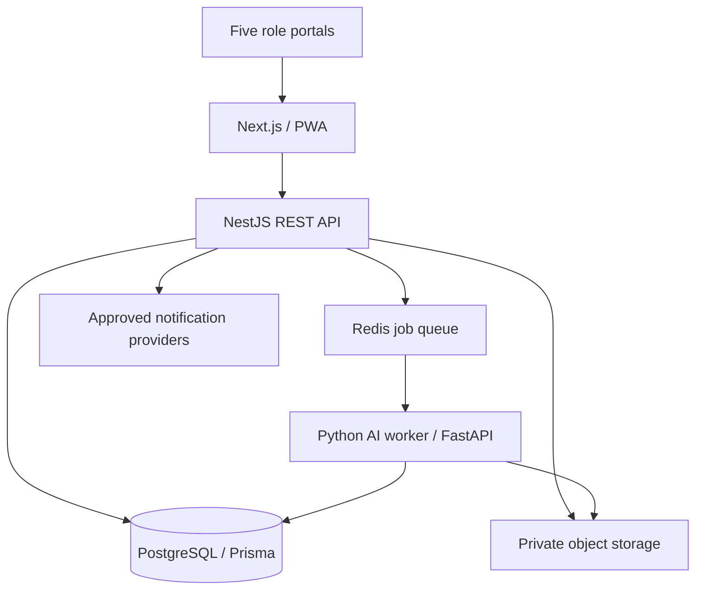

# Architecture

## Required stack
Next.js App Router + React + TypeScript; NestJS REST API; PostgreSQL + Prisma migrations; Python + FastAPI AI service; Redis and background queue; private S3-compatible evidence storage; Docker Compose for local development. Mobile target: responsive PWA first, then validated Android packaging approach.

## Trust boundaries
Browser/mobile input is untrusted. NestJS authenticates and authorizes every request. AI predictions are untrusted until reviewed. Object storage must be private. Worker credentials are least-privilege. Never commit secrets or embed them in a mobile bundle.

## Request flow
Authenticate → validate DTO → enforce role/ownership scope → transact database change → securely store evidence → enqueue idempotent AI job → save versioned candidate evidence → teacher review → transactionally finalize and audit → notify only for confirmed official absences.

## Deployment
Separate web, API, AI worker/service, PostgreSQL, Redis and private object storage. Select providers based on persistent storage, worker support, TLS, backups, secrets and budget. Document architectural decisions after repository audit: package manager, existing Prisma models, authentication, AI model/license, storage provider, Android approach and hosting.

## Resilience
AI failure must not take down academic records. Use bounded retries, timeouts, queue visibility, idempotency and authorized manual fallback. Separate API health from AI readiness.
